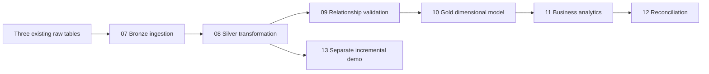

# Olist E-commerce Databricks Lakehouse

A batch lakehouse project using Databricks, PySpark, Spark SQL, and Delta tables. Seven original Databricks source exports implement bronze ingestion, silver cleaning, relationship checks, gold modeling and analytics, reconciliation, and a separate incremental MERGE demonstration.

## Pipeline

This is the recommended execution sequence derived from source dependencies. The live job dependency configuration has not been exported.

## Notebooks

| Notebook | Implementation |
| --- | --- |
| [07 Bronze ingestion](notebooks/07_olist_bronze_ingestion.py) | Reads three existing raw tables, adds `ingested_at`, overwrites three bronze Delta tables. |
| [08 Silver transformation](notebooks/08_olist_silver_transformation.py) | Filters required nulls and invalid item amounts, deduplicates keys, trims customer city, overwrites silver tables. |
| [09 Relationship validation](notebooks/09_olist_relationship_validation.py) | Asserts no missing customer references, orphan items, or duplicate order IDs. |
| [10 Gold dimensional model](notebooks/10_olist_gold_dimensional_model.py) | Creates a customer dimension and order-item fact; checks keys, references, and a dataset-specific fact count. |
| [11 Business analytics](notebooks/11_olist_gold_business_analytics.py) | Creates monthly and state delivered-sales summaries, plus counts of all silver orders by status. |
| [12 Gold reconciliation](notebooks/12_olist_gold_reconciliation.py) | Compares merchandise totals and reconciles order-status counts. |
| [13 Incremental loading](notebooks/13_olist_incremental_loading.py) | Demonstrates repeated Delta MERGE on a small subset and asserts expected counts, uniqueness, and incoming values. |

The `.py` exports retain Databricks notebook headers and cell delimiters. Source files are preserved unchanged.

## Setup and execution

See the [reproduction guide](docs/reproduction.md) for required input tables, columns, outputs, and execution order. The notebooks use `workspace.default`; change the catalog/schema references consistently when adapting to another workspace.

The source upload does not include raw data ingestion or dataset downloads. Supply the three required raw tables before running notebook 07. Use a Databricks environment with Spark and Delta support and permissions to read inputs and create/replace output tables.

## Metrics and model grain

- Customer dimension: one row per `customer_id`; `customer_unique_id` is retained for distinct-customer analytics.
- Fact: one row per `(order_id, order_item_id)`, joining silver items to silver orders. `item_total` is rounded price plus freight.
- Monthly sales: purchase month of delivered orders, distinct orders, item count, merchandise value, and freight.
- State sales: delivered-order merchandise/freight totals, distinct orders, and distinct customer unique IDs by customer state.
- Status model: counts every silver order by status, including orders without items.

Merchandise value is the sum of item prices, not profit or payment revenue. Sales models filter to delivered orders; the fact retains all statuses represented by item-bearing orders.

## Validation and evidence

All seven exports passed Python syntax parsing locally, and published source is checked against the supplied files. This does not execute Spark SQL or validate data in Databricks.

On 28 October 2026, the connected Databricks Free Edition job page showed `Olist_Ecommerce_Data_Lakehouse` with a successful manual run at 16:26 Europe/Berlin, duration 2m 36s, and serverless compute. Its six listed task names covered bronze, silver, relationship validation, gold modeling, analytics, and reconciliation. Notebook 13 was not listed among those tasks. This page observation is not a fresh execution of the exported code or a performance benchmark.

## Limitations

- Bronze and silver use overwrite; gold uses CREATE OR REPLACE. The main pipeline is a full batch rebuild.
- Notebook 13 is an isolated subset demonstration, not end-to-end incremental ingestion, CDC, or streaming. Running it from the beginning recreates its demo target.
- Notebook 10 asserts exactly 112,650 fact rows; notebook 13 assumes at least 105 silver orders and asserts 105 demo rows.
- Notebook 11 contains a repeated monthly-sales cell; notebook 13 repeats its MERGE count demonstration. These are retained from the originals.
- Invalid silver rows are filtered out without a quarantine table. Deduplication does not specify a deterministic winner for conflicting records sharing a key.
- Reconciliation checks merchandise totals with tolerance strictly below 0.10 and order-status counts; it does not reconcile every measure or individual record.
- Runtime versions, raw-table schemas/types, dataset provenance/license, and a portable job definition are not supplied. A clean-workspace end-to-end run remains unverified.

## Repository layout and license

`notebooks/` contains original source; `docs/` contains reproduction notes. Existing Python `.gitignore` and [MIT license](LICENSE) are retained. Third-party dataset rights and attribution must be verified separately before redistributing data.
